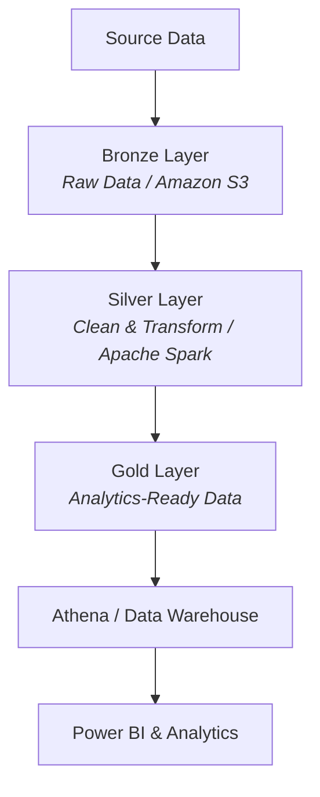
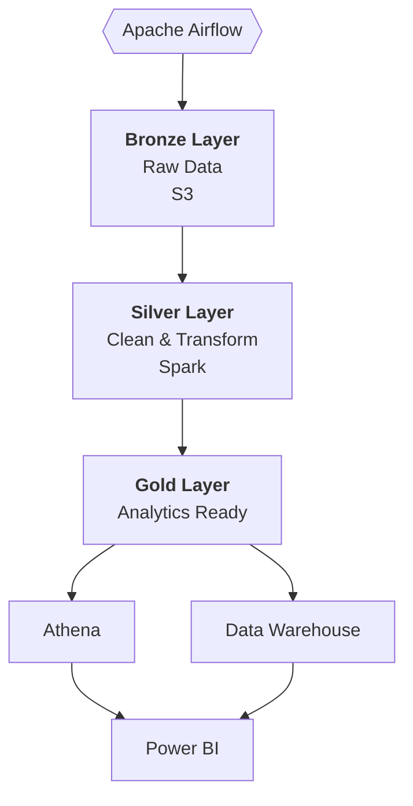

# AWS Data Engineering Project

> An end-to-end AWS data engineering pipeline orchestrated with **Apache Airflow**, following a **Medallion Architecture** (Bronze → Silver → Gold) to transform raw data into analytics-ready datasets.

---

## 🔄 Data Flow



---

## 📁 Project Structure

```text
aws_project/
│
├── dags/
│   └── aws_project.py          # Airflow DAG and orchestration
│
├── utils/
│   ├── bronze_layer.py         # Raw data ingestion
│   ├── silver_layer.py         # Data cleaning and transformation
│   └── gold_layer.py           # Business-ready datasets
│
├── config/
│   └── airflow.cfg             # Airflow configuration
│
├── Dockerfile                  # Airflow Docker image
├── docker-compose.yaml         # Local Airflow environment
└── requirements.txt            # Python dependencies
```

---

## 🛠️ Tech Stack

| Technology | Role |
|---|---|
| **AWS S3** | Data lake / raw data storage |
| **Apache Airflow** | Workflow orchestration |
| **Python** | ETL and transformation logic |
| **Apache Spark** | Data processing |
| **AWS Glue** | Data catalog and ETL |
| **Amazon Athena** | SQL-based analytics |
| **Amazon Redshift / Snowflake** | Data warehousing |
| **Power BI** | Reporting and visualization |
| **Docker** | Containerized development environment |

---

## ✨ Key Features

- 🥉🥈🥇 Medallion architecture with Bronze, Silver, and Gold layers
- ⏱️ Airflow DAGs for workflow orchestration and scheduling
- 🧩 Modular Python-based ETL processing
- 🔥 Data cleansing and transformation using Spark
- ☁️ Integration with AWS data lake and analytics services
- 🐳 Dockerized Airflow environment for local development
- 📈 Analytics-ready datasets for BI and reporting

---

## 🚀 Run Locally

**1. Start the Airflow environment**

```bash
docker compose up -d
```

**2. Open Airflow**

Navigate to [http://localhost:8080](http://localhost:8080)

**3. Run the Pipeline**

Find the `aws_project` DAG in the Airflow UI and trigger it manually to execute the Bronze → Silver → Gold pipeline.

---

## 📊 Pipeline Architecture

The pipeline separates orchestration from data processing logic:



---

## 🎯 Project Objective

The goal of this project is to demonstrate an end-to-end cloud data engineering workflow using AWS and Apache Airflow, with a scalable and modular architecture for transforming raw data into reliable datasets for analytics and reporting.
